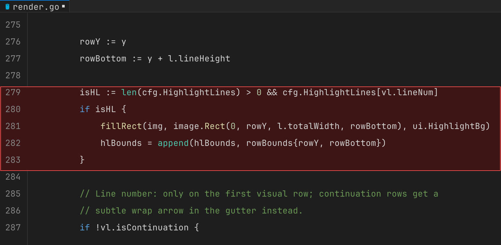
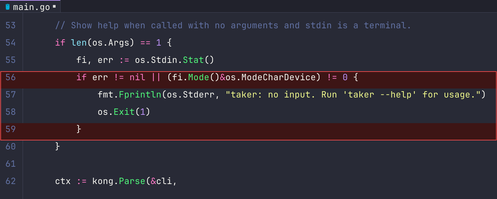
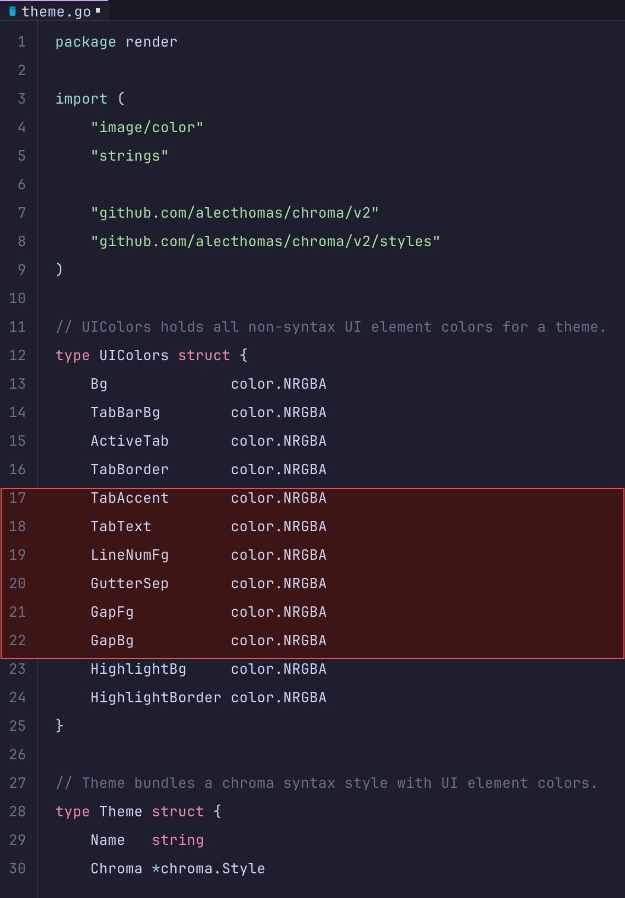
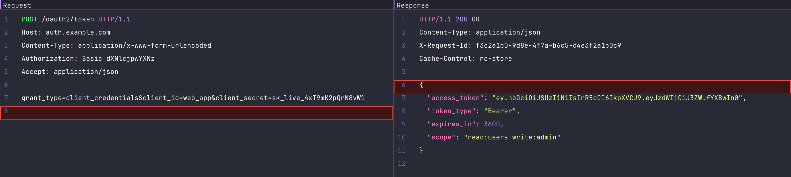

# taker

A CLI tool for generating professional, publication-ready code and HTTP evidence screenshots for security audits, SAST pipelines, MCP servers, and AI agents.

Produces VS Code Dark+-styled PNG images with syntax highlighting, line numbers, file icons, and red highlight overlays — without requiring a browser, Electron, or any GUI dependency. Single self-contained binary with embedded fonts.

---

## Installation

### Download binary (recommended)

Download the latest release for your platform from the [releases page](https://github.com/tachote/taker/releases):

```bash
# macOS (Apple Silicon)
curl -L https://github.com/tachote/taker/releases/latest/download/taker_Darwin_arm64.tar.gz | tar xz
sudo mv taker /usr/local/bin/

# macOS (Intel)
curl -L https://github.com/tachote/taker/releases/latest/download/taker_Darwin_x86_64.tar.gz | tar xz
sudo mv taker /usr/local/bin/

# Linux (amd64)
curl -L https://github.com/tachote/taker/releases/latest/download/taker_Linux_x86_64.tar.gz | tar xz
sudo mv taker /usr/local/bin/
```

### go install

```bash
go install github.com/tachote/taker@latest
```

Requires Go 1.22+.

### Build from source

```bash
git clone https://github.com/tachote/taker
cd taker
go build -o taker .
```

---

## Features

- **VS Code Dark+ aesthetics** — tab bar, gutter, syntax highlighting, file type icons (Nerd Fonts)
- **10 built-in themes** — VS Code Dark+, Dracula, Nord, Catppuccin Mocha, GitHub Dark, Gruvbox, One Dark, Monokai, Solarized Dark, Rosé Pine
- **Line selection** — render only the lines you need (`1,5,10-20,30-40`), with automatic gap indicators (`⋮`) between non-adjacent ranges
- **Context mode** — automatically include N lines around highlighted lines (`--context 5`)
- **Highlight overlay** — red background + border on arbitrary lines or ranges (`13,15` or `10-20`)
- **Word wrap** — wrap long lines with continuation indicators, like VS Code
- **HTTP evidence mode** — side-by-side Request / Response panels for documenting HTTP vulnerabilities
- **Stdin support** — pipe code directly without creating a temp file
- **Self-contained binary** — JetBrains Mono and Symbols Nerd Font are embedded; no runtime dependencies

---

## Usage

### Code evidence

```
taker [file] [flags]
```

| Flag | Short | Default | Description |
|------|-------|---------|-------------|
| `--lang` | `-l` | auto | Language for syntax highlighting |
| `--lines` | `-n` | all | Lines to include, e.g. `1,5,10-20` |
| `--highlight` | `-H` | — | Lines to highlight in red, e.g. `15` or `13,15` or `10-20` |
| `--context` | `-c` | 0 | Include N context lines around each highlighted line |
| `--wrap` | `-w` | false | Wrap long lines (VS Code-style word wrap) |
| `--wrap-width` | | 100 | Column width when wrapping |
| `--title` | `-t` | filename | Title shown in the tab bar |
| `--theme` | `-T` | `vscode-dark` | Color theme |
| `--output` | `-o` | `output.png` | Output PNG path |
| `--list-themes` | | | Print available themes and exit |

#### Examples

```bash
# Render a full file
taker auth.go -o evidence.png

# Highlight a specific vulnerability (line 42)
taker auth.py -H 42 -o evidence.png

# Highlight with 5 lines of context — ideal for SAST/AI agents
taker auth.py -H 42 -c 5 -o evidence.png

# Non-contiguous lines with gap indicator
taker config.go -n "1-10,45-60" -H "52,57" -o evidence.png

# Wrap long lines (e.g. YAML with inline comments)
taker application.yml -H "13,15" -c 4 -w -o evidence.png

# From stdin
cat vuln.js | taker -l javascript -t "vuln.js" -H 8 -o evidence.png

# Dracula theme
taker secrets.py -H 15 -T dracula -o evidence.png
```

**Highlight + context (VS Code Dark+):**

```bash
taker render/render.go -H 279-283 -c 4 -o evidence.png
```



**Dracula theme, non-contiguous highlights:**

```bash
taker main.go -H 56,59 -c 3 -T dracula -o evidence.png
```



**Catppuccin Mocha, line selection:**

```bash
taker render/theme.go -n "1-30" -H 17-22 -T catppuccin-mocha -o evidence.png
```



### HTTP evidence

```
taker http -r <request-file> -s <response-file> [flags]
```

Renders a side-by-side Request / Response panel image, similar to Burp Suite's repeater view.

| Flag | Description |
|------|-------------|
| `-r` | File containing the raw HTTP request |
| `-s` | File containing the raw HTTP response |
| `--hr` | Lines to highlight in the request panel |
| `--hs` | Lines to highlight in the response panel |
| `--wrap-width` | Columns per panel (default: 90) |
| `-T` | Color theme |
| `-o` | Output PNG path |

#### Examples

```bash
# Basic HTTP evidence
taker http -r request.http -s response.http -o evidence.png

# Highlight the credential leak line in request and the token in response
taker http -r request.http -s response.http --hr "8" --hs "15" -o evidence.png

# Wider panels for responses with long headers
taker http -r req.http -s res.http --wrap-width 110 -o evidence.png
```

**Credential leak — highlighted request line 8, response line 6 (Dracula):**

```bash
taker http -r request.http -s response.http --hr 8 --hs 6 -T dracula -o evidence.png
```



**Request file format** (`request.http`):
```
POST /oauth2/token HTTP/2
Host: auth.example.com
Content-Type: application/x-www-form-urlencoded

grant_type=client_credentials&client_secret=EXPOSED_SECRET
```

**Response file format** (`response.http`):
```
HTTP/2 200 OK
Content-Type: application/json

{"access_token": "eyJ..."}
```

---

## Themes

```bash
taker --list-themes
```

| Key | Name |
|-----|------|
| `vscode-dark` *(default)* | VS Code Dark+ |
| `dracula` | Dracula |
| `nord` | Nord |
| `catppuccin-mocha` | Catppuccin Mocha |
| `github-dark` | GitHub Dark |
| `gruvbox` | Gruvbox |
| `one-dark` | One Dark |
| `monokai` | Monokai |
| `solarized-dark` | Solarized Dark |
| `rose-pine` | Rosé Pine |

---

## Integration

### MCP server (AI agents)

`taker` is designed to be called by MCP servers and AI agents as part of automated security reporting pipelines. The binary is fully autonomous — no dialogs, no GUI, no network access.

```python
import subprocess

def generate_evidence(file_path: str, highlight_lines: str, context: int = 5, output: str = "evidence.png") -> str:
    result = subprocess.run([
        "taker", file_path,
        "--highlight", highlight_lines,
        "--context", str(context),
        "--output", output,
    ], capture_output=True, text=True)
    if result.returncode != 0:
        raise RuntimeError(result.stderr)
    return output
```

### SAST pipeline

```yaml
# GitHub Actions example
- name: Generate vulnerability evidence
  run: |
    taker src/auth/login.py \
      --highlight "${{ env.VULN_LINE }}" \
      --context 5 \
      --theme github-dark \
      --output evidence/${{ env.FINDING_ID }}.png
```

### Fluid Attacks MCP integration

`taker` is the evidence generation backend for the [fluid-mcp](https://github.com/cvargas/fluid-mcp) server. The `generate_code_evidence` tool calls `taker` to produce screenshot evidence that is then uploaded to Fluid Attacks Integrates via GraphQL.

---

## How it works

```
Source file
    │
    ▼
highlight.Tokenize()          ← chroma lexer (200+ languages)
    │  syntax tokens with RGB colors
    ▼
highlight.FilterLines()       ← apply --lines spec, insert gap sentinels
    │
    ▼
render.buildVisualLines()     ← apply word wrap if --wrap
    │
    ▼
render.Render()               ← 4-pass image composition
    │   Pass 1: fill backgrounds (editor, tab bar, gutter)
    │   Pass 2: draw header (tab bar or HTTP panel header)
    │   Pass 3: draw visual lines (line numbers, tokens, highlights)
    │   Pass 4: draw highlight border
    ▼
png.Encode()                  ← output PNG at 144 DPI (2× retina quality)
```

For HTTP mode, `RenderHTTP()` runs two parallel render passes and composites the panels side by side with a vertical divider.

---

## Supported languages

Any language supported by [chroma](https://github.com/alecthomas/chroma) — 200+ lexers including Go, Python, JavaScript, TypeScript, Java, Rust, PHP, Ruby, C/C++, C#, YAML, JSON, SQL, Bash, HCL/Terraform, XML, HTML, and HTTP.

Language is auto-detected from the file extension. Override with `--lang`:

```bash
taker payload.txt --lang sql -H 3 -o evidence.png
```

---

## File type icons

Icons are rendered using [Symbols Nerd Font](https://www.nerdfonts.com/) embedded in the binary. Supported file types with distinct icons:

`.go` `.py` `.js` `.ts` `.tsx` `.jsx` `.rs` `.java` `.rb` `.php` `.cs` `.c` `.cpp` `.h` `.html` `.css` `.scss` `.yaml` `.yml` `.md` `.sh` `.sql` `.tf` `.hcl` `.xml`

---

## Dependencies

| Package | Purpose |
|---------|---------|
| [alecthomas/chroma](https://github.com/alecthomas/chroma) | Syntax highlighting (200+ languages) |
| [alecthomas/kong](https://github.com/alecthomas/kong) | CLI flag parsing |
| [golang.org/x/image](https://pkg.go.dev/golang.org/x/image) | Font rendering, image primitives |

**Embedded assets:**
- [JetBrains Mono](https://www.jetbrains.com/lp/mono/) — code font (SIL Open Font License 1.1)
- [Symbols Nerd Font](https://www.nerdfonts.com/) — file type icons (MIT License)

---

## License

MIT — see [LICENSE](LICENSE).

Third-party licenses:
- **JetBrains Mono**: [SIL Open Font License 1.1](https://scripts.sil.org/OFL)
- **Symbols Nerd Font**: [MIT License](https://github.com/ryanoasis/nerd-fonts/blob/master/LICENSE)
- **chroma**: [MIT License](https://github.com/alecthomas/chroma/blob/master/COPYING)
- **kong**: [MIT License](https://github.com/alecthomas/kong/blob/master/LICENSE)
