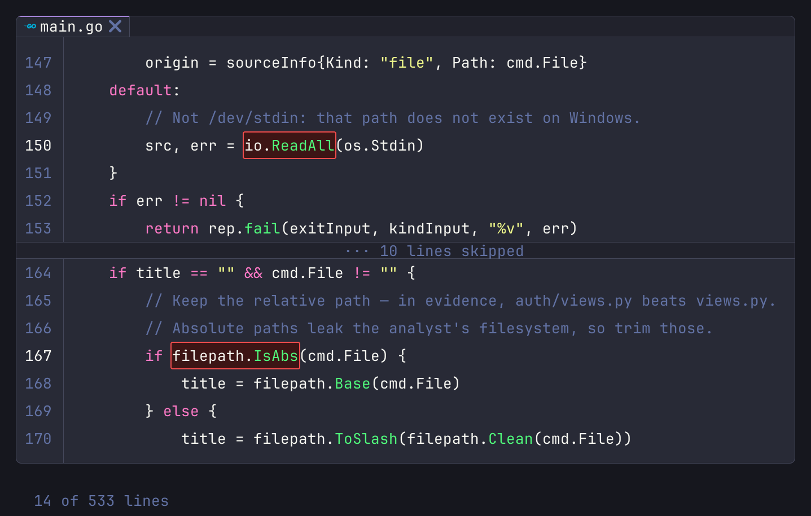
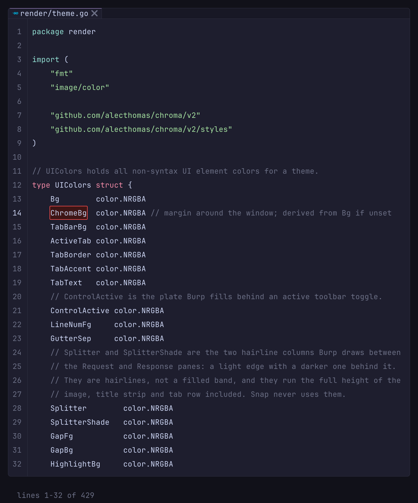
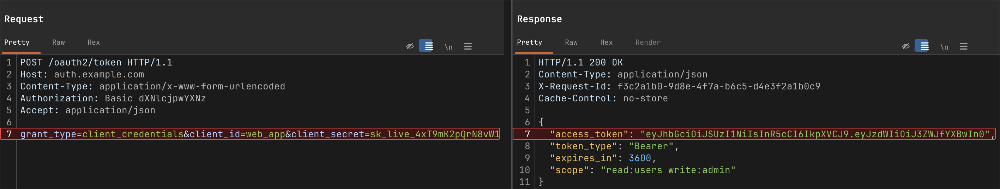

# taker

A CLI tool for generating professional, publication-ready code and HTTP evidence screenshots for security audits, SAST pipelines, MCP servers, and AI agents.

Produces VS Code Dark+-styled PNG images with syntax highlighting, line numbers, file icons, and red highlight overlays — without requiring a browser, Electron, or any GUI dependency. Single self-contained binary with embedded fonts.

---

## Installation

### Download binary (recommended)

Download the latest release for your platform from the [releases page](https://github.com/tachote/taker/releases). taker produces audit evidence, so verify the archive against the release's `checksums.txt` before you install it:

```bash
# Pick the archive for your platform:
#   taker_darwin_arm64.tar.gz   macOS (Apple Silicon)
#   taker_darwin_amd64.tar.gz   macOS (Intel)
#   taker_linux_amd64.tar.gz    Linux (x86_64)
#   taker_linux_arm64.tar.gz    Linux (arm64)
#   taker_windows_amd64.zip     Windows (x86_64)
ASSET=taker_darwin_arm64.tar.gz
BASE=https://github.com/tachote/taker/releases/latest/download

# Each step runs only if the previous one succeeded: a failed download or a
# checksum mismatch stops the install before anything is extracted.
# Linux: use `sha256sum --ignore-missing -c checksums.txt` instead of shasum.
curl -fLO "$BASE/$ASSET" &&
  curl -fLO "$BASE/checksums.txt" &&
  shasum -a 256 --ignore-missing -c checksums.txt &&
  tar xzf "$ASSET" taker &&
  sudo mv taker /usr/local/bin/
```

If the check prints `FAILED`, do not install: delete the archive and download it again.

On Windows, compare the `Get-FileHash -Algorithm SHA256 taker_windows_amd64.zip` output with the `taker_windows_amd64.zip` line in `checksums.txt`. Extract `taker.exe` only if the two hashes are identical; if they differ, delete the zip and do not run anything from it.

### go install

```bash
go install github.com/tachote/taker@latest
```

Requires Go 1.22+.

### Build from source

```bash
git clone https://github.com/tachote/taker
cd taker
go build -o taker .
```

---

## Features

- **VS Code Dark+ aesthetics** — window chrome with rounded corners, tab bar, gutter, syntax highlighting
- **Brand-colored file icons** — 260+ extensions and filenames (`Dockerfile`, `go.mod`, `.env`, `pom.xml`), each a real Nerd Fonts logo in its language color
- **11 built-in themes** — VS Code Dark+, Dracula, Nord, Catppuccin Mocha, GitHub Dark, GitHub Light, Gruvbox, One Dark, Monokai, Solarized Dark, Rosé Pine
- **Window chrome and shadow** — `--chrome window` adds a title bar with traffic lights and the file name centred; `--shadow` lifts the pane off the canvas
- **Line selection** — render only the lines you need (`1,5,10-20,30-40`), with gap bands stating how many lines were skipped
- **Context mode** — automatically include N lines around highlighted lines (`--context 5`)
- **Point at the finding, not the line** — mark a column range (`-H "7:63-85"`), paste the value itself (`-m "sk_live_4xT9mK2pQrN8vW1"`), or match a shape (`--mark-re "eyJ[A-Za-z0-9_-]+"`)
- **Redaction that declares itself** — `--redact` hides secrets under a black box and the footnote says how many regions were masked; `--redact-keep 4` leaves `sk_l…████` legible. Redact literals are scrubbed from the report's `command` and the PNG's metadata too — a hidden value never travels verbatim in the same file's provenance
- **Captions** — `-L` adds a strip stating what the image proves, drawn outside the window so it never reads as something the tool under test printed
- **Word wrap** — wrap long lines with continuation indicators; wraps automatically rather than cropping
- **HTTP evidence mode** — side-by-side Request / Response pane that mimics Burp Suite's message editor, so evidence reads like a Burp screenshot; also single-panel (`-r` or `-s` alone) and combined captures (`-f`, Burp "Save item" format)
- **Terminal evidence mode** — `taker exec -- id` runs a command and renders the prompt plus output under a terminal window; `taker term` renders a saved transcript
- **Provenance built in** — every PNG embeds the command line, timestamp, version and input SHA-256 as `tEXt` chunks; `--json` reports the same fields
- **Preflight for agents** — `--dry-run` validates the whole render and reports the image's dimensions without writing it
- **Stdin support** — pipe code directly without creating a temp file; if nothing arrives on stdin within 300ms it fails as `usage` instead of hanging on an empty pipe
- **Self-contained binary** — JetBrains Mono and Symbols Nerd Font are embedded; no runtime dependencies

---

## Usage

### Code evidence

```
taker [file] [flags]
```

| Flag | Short | Default | Description |
|------|-------|---------|-------------|
| `--lang` | `-l` | auto | Language for syntax highlighting |
| `--lines` | `-n` | all | Lines to include, e.g. `1,5,10-20` |
| `--first-line` | | 1 | Line number of the input's first line (use it when piping an excerpt) |
| `--git` | | — | Render the file `<rev>:<path>` out of the repository, e.g. `HEAD:src/auth/login.py` — the committed bytes, no textconv; a directory is refused (exit 3), a value without `<rev>:<path>` is a usage error (exit 2) |
| `--repo-dir` | | `.` | Repository directory for `--git` |
| `--highlight` | `-H` | — | Regions to highlight in red: `15`, `13,15`, `10-20`, or `15:20-45` for columns |
| `--mark` | `-m` | — | Highlight every occurrence of this text; a comma is part of it. Repeat `-m` for more |
| `--mark-re` | | — | Highlight every regex match. Repeatable |
| `--max-marks` | | 0 (all) | Keep at most N matches per `--mark` literal, earliest first |
| `--redact` | | — | Hide every occurrence of this text under a black box. Repeatable |
| `--redact-re` | | — | Hide every regex match under a black box. Repeatable |
| `--redact-keep` | | 0 | Leave the first N characters of each `--redact` match visible (`4` → `sk_l…████`). A run where any match is N characters or shorter is refused (exit 2): that match would be drawn in full |
| `--label` | `-L` | — | Caption stating what the image proves |
| `--context` | `-c` | 0 | Include N context lines around each highlighted line |
| `--wrap` | `-w` | false | Wrap long lines at a column boundary |
| `--wrap-width` | | 100 | Column width when wrapping (implies `--wrap`; floor 20) |
| `--title` | `-t` | file path | Title shown in the tab bar |
| `--theme` | `-T` | `vscode-dark` | Color theme |
| `--chrome` | | `editor` | Window style: `editor` (bare pane) or `window` (title bar + traffic lights) |
| `--shadow` | | false | Drop shadow under the window |
| `--output` | `-o` | `output.png` | Output PNG path |
| `--dry-run` | | | Validate and report without writing the PNG |
| `--list-themes` | | | Print available themes and exit |
| `--json` | | | Write a machine-readable report to stdout. Human messages stay on stderr |
| `--toon` | | | Same document in TOON — typically ~25-40% fewer tokens for agents |

#### Examples

```bash
# Render a full file
taker auth.go -o evidence.png

# Highlight a specific vulnerability (line 42)
taker auth.py -H 42 -o evidence.png

# Box the secret itself — no column counting
taker auth.py -m "sk_live_4xT9mK2pQrN8vW1" -o evidence.png

# Or give the columns explicitly
taker auth.py -H "42:18-41" -o evidence.png

# Hide a live secret but keep the image honest: the box says where it was and
# the footnote declares the count
taker auth.py --redact "sk_live_4xT9mK2pQrN8vW1" --redact-keep 6 -o evidence.png

# Mark a pattern — every bearer-shaped token, not one pasted literal
taker auth.py --mark-re "Bearer [A-Za-z0-9_.-]+" -o evidence.png

# Caption it so the image explains itself in the report
taker auth.py -m "sk_live_4xT9mK2pQrN8vW1" \
  -L "SOLTAU-005 · client secret hardcoded in the mobile build" -o evidence.png

# Highlight with 5 lines of context — ideal for SAST/AI agents
taker auth.py -H 42 -c 5 -o evidence.png

# Render just the vulnerable function out of a 2000-line file, with the gutter
# still showing the real line numbers
sed -n '500,515p' auth.py \
  | taker --first-line 500 -m "sk_live_4xT9mK2pQrN8vW1" -c 3 -o evidence.png

# Render the code as it is in a revision, with no copy of it in between. The
# image carries the file and the commit it came from.
taker --git 9f344fad66cf0387436a3bf0628b44756ce7abfe:src/auth/login.py \
  -H 172 -c 6 -o evidence.png

# Non-contiguous lines with gap indicator
taker config.go -n "1-10,45-60" -H "52,57" -o evidence.png

# Wrap long lines (e.g. YAML with inline comments)
taker application.yml -H "13,15" -c 4 -w -o evidence.png

# From stdin
cat vuln.js | taker -l javascript -t "vuln.js" -H 8 -o evidence.png

# Dracula theme
taker secrets.py -H 15 -T dracula -o evidence.png
```

**Highlight + context (VS Code Dark+):**

```bash
taker render/render.go -m "maxImageHeight" -c 4 -o evidence.png
```


**Dracula theme, two marks found by content:**

```bash
taker main.go -m "io.ReadAll" -m "filepath.IsAbs" -c 3 -T dracula -o evidence.png
```



**Catppuccin Mocha, line selection plus a content mark:**

```bash
taker render/theme.go -n "1-32" -m "ChromeBg" -T catppuccin-mocha -o evidence.png
```



### HTTP evidence

```
taker http [-r <request-file>] [-s <response-file>] | -f <capture-file> [flags]
```

Renders a side-by-side Request / Response pane built to look like Burp Suite's message editor: title strip, `Pretty | Raw | Hex` view tabs with the active one underlined, dense line spacing, a gutter with no rule, and wrapped rows left unnumbered the way Burp does it. Headers are near-monochrome with only the JSON body colored, matching Burp's Pretty view.

| Flag | Description |
|------|-------------|
| `-r` | File containing the raw HTTP request |
| `-s` | File containing the raw HTTP response |
| `-f` | One file holding request **and** response (Burp "Save item"); `-r`/`-s` take precedence |
| `--hr` | Regions to highlight in the request: `8-9`, or `8:20-45` for columns |
| `--hs` | Regions to highlight in the response: `4`, or `4:12-60` for columns |
| `--mark` / `-m` | Highlight every occurrence of this text in either panel; a comma is part of it. Repeat `-m` for more |
| `--mark-re` | Highlight every regex match in either panel. Repeatable |
| `--max-marks` | Keep at most N matches per `--mark` literal, earliest first |
| `--redact` | Hide every occurrence of this text under a black box. Repeatable |
| `--redact-re` | Hide every regex match under a black box. Repeatable |
| `--redact-keep` | Leave the first N characters of each `--redact` match visible |
| `--label` / `-L` | Caption stating what the image proves |
| `--nr` | Lines to include from the request, e.g. `1-20` |
| `--ns` | Lines to include from the response, e.g. `1-30` |
| `-c` | Include N context lines around each highlighted line |
| `--wrap-width` | Columns per panel (default: 90) |
| `-o` | Output PNG path |
| `--dry-run` | Validate and report without writing the PNG |
| `--json` | Machine-readable report on stdout; human messages stay on stderr |
| `--toon` | Same document in TOON — typically ~25-40% fewer tokens for agents |

There is no `-T` here. HTTP evidence always renders in the Burp palette: a reader recognises a proxy capture at a glance, and a Dracula-tinted pane labelled *Request / Response / Pretty / Raw / Hex* is a screenshot of an application that does not exist.

`-c` only applies to a panel that has highlights, so a response-only finding still renders its request in full.

`-r` or `-s` may be given alone — a data leak is often the response by itself — and then the pane drops to a single panel with no splitter. `-f` reads one capture the way Burp's "Save item" writes it: request first, split on the response status line; a file that is not HTTP at all is an input error, and one with no response section renders the request with a warning. A trim or context crop that leaves out the request line (`POST /x HTTP/1.1`) or the response status line emits a warning, because that line names where the message went — the surface of the finding.

#### Examples

```bash
# Basic HTTP evidence
taker http -r request.http -s response.http -o evidence.png

# One Burp "Save item" file — no manual split into request/response
taker http -f capture.http -m "sessionid=42" -o evidence.png

# Response-only evidence (data leak)
taker http -s response.http --hs 7 -o evidence.png

# Mask the live bearer token in both panels; the footnote declares the count
taker http -r request.http -s response.http \
  --redact-re "eyJ[A-Za-z0-9_-]+\.[A-Za-z0-9_-]+\.[A-Za-z0-9_-]+" -o evidence.png

# Highlight the credential leak line in request and the token in response
taker http -r request.http -s response.http --hr "7" --hs "7" -o evidence.png

# Wider panels for responses with long headers
taker http -r req.http -s res.http --wrap-width 110 -o evidence.png

# A long body: show 6 lines around the finding instead of all 3000
taker http -r req.http -s res.http --hs 1520 -c 6 -o evidence.png

# Response headers only
taker http -r req.http -s res.http --ns 1-30 -o evidence.png

# Box a value wherever it appears, in either panel, and caption the finding
taker http -r req.http -s res.http \
  -m "sk_live_4xT9mK2pQrN8vW1" -m "read:users write:admin" \
  -L "SOLTAU-005 · client_secret in the body; returned token grants write:admin" \
  -o evidence.png
```

**Credential leak — highlighted request line 7, response line 7:**

```bash
taker http -r request.http -s response.http --hr 7 --hs 7 -o evidence.png
```



**Request file format** (`request.http`):
```
POST /oauth2/token HTTP/2
Host: auth.example.com
Content-Type: application/x-www-form-urlencoded

grant_type=client_credentials&client_secret=EXPOSED_SECRET
```

An HTTP/2 request copied in pseudo-header form (DevTools, HTTP/2 proxies),
with no request line, is accepted too: its first line is `:method:`,
`:path:`, `:authority:` or `:scheme:`.

**Response file format** (`response.http`):
```
HTTP/2 200 OK
Content-Type: application/json

{"access_token": "eyJ..."}
```

### Terminal evidence

```
taker exec -- <command> [args...] [flags]
taker exec --sh '<pipeline>' [flags]
taker term <transcript-file> [flags]
```

The canonical evidence of a command-injection finding is the command and its output — `$ id` answering `uid=33(www-data)`. `taker exec` runs the command itself, prepends the `$ prompt` line, and renders the transcript under a terminal title bar (no source-line gutter); `taker term` draws a transcript you already captured. The exit status lands in the footnote (`exit 0`, `exit 1`, `killed by SIGSEGV`, `killed after Ns` when `--timeout` stopped it), so a non-zero result is documented, not hidden. The status is the command's own: a background process it leaves holding the output is given 2 more seconds, then killed with the command's process group, and the footnote adds `output cut 2s later`. Output past 10000 lines or 4 MiB cannot render under the 32000px cap, so `taker exec` kills the command and refuses (exit 4) instead of drawing a cut transcript; pipe it through `head`.

| Flag | Description |
|------|-------------|
| `--sh` | Run the string through `sh -c` instead of exec'ing argv (mutually exclusive with a positional command) |
| `--timeout` | Kill the command after this many seconds (default: 15, minimum 1) |
| `--lines` / `-n` | Lines of the transcript to include |
| `--wrap-width` | Terminal width in columns (default: 80) |
| `-m` / `--mark` / `--mark-re` | Highlight literals / regex matches in the output |
| `--redact` / `--redact-re` / `--redact-keep` | Mask output the same way as code evidence |
| `-L` | Caption stating what the image proves |
| `-T` | Color theme |
| `-o` | Output PNG path |
| `--json` | Machine-readable report on stdout |
| `--toon` | Same document in TOON — typically ~25-40% fewer tokens for agents |

```bash
# Run the proof command and keep its output, exit code included
taker exec -- id -o rce.png
taker exec --sh 'curl -s http://internal:8080/actuator/env | head' -o ssrf.png
taker exec --timeout 5 -- nc -nv 10.0.0.9 443 -o port-open.png

# Render a transcript captured during the test window
taker term ./loot/nmap-scan.txt -m "open" -o ports.png
```

---

## Fidelity to Burp

`taker http` takes its colours from Burp Suite's own theme definition — `burp/theme/DarkTheme.json` inside the application bundle, section `colors.ui.editor.message`, where Burp names every role (`headerName`, `cookieValue`, `paramName`, `literalString`, `lineNumbers`, `gutterBorder`). Geometry (row pitch, header height, tab spacing) is measured off a real capture, and the capture is the acceptance test for both.

A structured body keeps the role colours Burp gives it: a json key comes out gold, its string value green, numbers and `true`/`false` their own colours, and the braces, colon and comma stay plain text — measured on a capture, not inferred from the role names.

Reading the palette from the source rather than from screenshot pixels is not pedantry: sampling anti-aliased text returns blends, and one earlier version of this palette carried a rule about "hex-looking" cookie values that came from reading a colour off the wrong row. Burp has a single `cookieValue` colour and it paints every cookie value with it.

Four things are deliberately **not** reproduced, because they are state rather than style:

| Not drawn | Why |
|---|---|
| The caret's current-line band | It marks where the cursor happened to be. Drawing it would claim a cursor position in an image that has no editor behind it. |
| The scrollbar track | Same reason: it reports a scroll offset that does not exist. |
| Non-printing-character dots | They encode invisible characters the analyst never chose to show. |
| The pane drag handle | Interactive chrome; it invites a click that cannot happen. |

Burp's panels are split evenly between request and response. `taker` sizes each pane to its content instead, because the empty half of an even split is not evidence — and an even split costs enough width that the default wrap drops from 90 to about 66 columns, wrapping long cookies and bodies further.

## Themes

```bash
taker --list-themes
```

| Key | Name |
|-----|------|
| `vscode-dark` *(default)* | VS Code Dark+ |
| `burp` | Burp Suite (dark) — used by `taker http` and **only** there: its style covers the HTTP lexer's tokens, so source code would render flat |
| `dracula` | Dracula |
| `nord` | Nord |
| `catppuccin-mocha` | Catppuccin Mocha |
| `github-dark` | GitHub Dark |
| `github-light` | GitHub Light — for reports and PDFs that sit on white |
| `gruvbox` | Gruvbox |
| `one-dark` | One Dark |
| `monokai` | Monokai |
| `solarized-dark` | Solarized Dark |
| `rose-pine` | Rosé Pine |

---

## Machine-readable report (`--json` / `--toon`)

An agent or a pipeline should not have to read the messages a human reads. With
`--json`, **stdout carries one JSON document** describing the run, while stderr
keeps the human lines. `--toon` writes the same document in
[TOON](https://toonformat.dev/) — identical information, typically 25-40% fewer tokens for
an agent to read:

```console
$ taker snap src/auth.py -m os.system -c 5 --toon -o auth.png
```
```
tool: taker
version: 0.2.0
mode: snap
ok: true
exit: 0
command: "taker snap src/auth.py -m os.system -c 5 --toon -o auth.png"
generated: "2026-04-12T18:02:11Z"
output: /abs/path/auth.png
bytes: 16099
width: 573
height: 293
source:
  kind: file
  path: src/auth.py
crop:
  first: 66
  last: 76
  shown: 11
  total: 120
marks[1]{needle,matches,lines,kept,dropped,shown}:
  os.system,1,1,1,0,1
sha256[1]{name,sum}:
  source,b94d27b9934d3e08a52e52d7da7dabfac484efe37a5380ee9088f7ace2efcde9
warnings[0]:
```

Without either flag a **successful** run leaves stdout empty — the PNG is the
artifact. A **failed** run always writes a document in the TOON shape above
(`ok: false`, `exit`, `error.kind`, `error.message`), so a caller that never
passed a format flag still gets something it can classify instead of grepping
stderr prose.

```console
$ taker snap src/auth.py --first-line 70 -m os.system -c 5 --json -o auth.png
```
```json
{
  "tool": "taker",
  "version": "0.2.0",
  "mode": "snap",
  "ok": true,
  "exit": 0,
  "command": "taker snap src/auth.py --first-line 70 -m os.system -c 5 --json -o auth.png",
  "generated": "2026-04-12T18:02:11Z",
  "output": "/abs/path/auth.png",
  "bytes": 16099,
  "width": 573,
  "height": 293,
  "source": { "kind": "file", "path": "src/auth.py" },
  "crop": { "first": 70, "last": 71, "shown": 2, "total": null },
  "marks": [ { "needle": "os.system", "matches": 1, "lines": 1, "kept": 1, "dropped": 0, "shown": 1 } ],
  "sha256": [ { "name": "source", "sha256": "b94d…" } ],
  "redactions": 0,
  "dry_run": false,
  "warnings": []
}
```

The report echoes `--mark`/`--mark-re` needles verbatim — they are instructions
to circle, not secrets — while `--redact` literals are masked everywhere,
including inside `warnings[]` and `command`. Do not pass a mark you would not
want recorded.

A run that fails says so in the same document, so a consumer never has to branch
on "did anything come out of stdout":

```json
{
  "tool": "taker", "version": "0.2.0", "mode": "snap",
  "ok": false, "exit": 3, "warnings": [],
  "error": { "kind": "input", "message": "open nope.py: no such file or directory" }
}
```

**The fields describe what was written, not what was asked for.** `width`,
`height` and `bytes` are read back off the PNG. `crop` is the extent the image
shows, in the source's own numbering, and its `total` is `null` when the input did
not start at line 1 — an excerpt's real length is not something taker knows, and a
wrong total is worse than none. `panels` carries one `crop` per pane that exists
in `taker http` — an absent pane is `null`, not a zero crop. `marks` reports, per
literal or pattern, over the whole input: how many matches `--max-marks` kept
(`kept`) and left out (`dropped`), and how many kept matches sit on a line the
image shows (`shown`) — a `--lines`/`--context`/`--nr`/`--ns` trim can leave a
kept match out of the view, so assert on `shown`, not `kept`, to know a box is
in the image. `sha256` fingerprints every input that fed the image (`source`,
`request`, `response`, `transcript`), and `command`/`generated` record the exact
invocation (shell-quoted so it replays, with the binary's base name instead of
its path) and its UTC time — the same provenance the PNG itself embeds as `tEXt`
chunks (`taker:sha256`, `taker:command`, `taker:generated`, `taker:version`), so an
image that travels without the report still describes itself — with one
exception: every `--redact` literal is replaced by `<redacted>` in `command`
and in the PNG chunks, because a masked value must not leak through
provenance. Each `sha256` covers the input as taker matched and drew it, in
every mode: first normalized (ANSI escapes stripped; text composed to Unicode
NFC; BOM, zero-width and other invisible format characters, and combining
marks with no precomposed form, removed), then masked (every `--redact` literal,
its double-quoted form, its separator-split parts of 3 bytes or more, and
every `--redact-re` match replaced by `<redacted>`, longest match first, left
to right). A hash of the raw bytes would let anyone who holds the image
confirm guesses at a short secret. So `sha256sum <file>` equals the reported
sum only for a plain file with nothing redacted; to check any other run,
apply the same two steps first. `redactions` counts
the black boxes the footnote declares. For `taker exec`, `exec` carries the
child command's outcome (`exit`, `timed_out`, and `signal` — `SIGKILL`,
`SIGSEGV` — with `exit` null when a signal ended it) — taker's own `exit` says
the evidence was produced, `exec.exit` says what the command answered. `warnings`
holds the same caveats the
terminal shows — a mark that landed outside the view, a redaction that matched
nothing, a trim that cut the request line — so they survive a consumer that never
reads stderr. `--dry-run` runs the whole pipeline and reports the same document
with `dry_run: true` and no `output`, for a preflight that never writes.
`help` carries the next command that unblocks or completes the run — widen the
trim, fix the flag, rerun without `--dry-run` — so a consumer never has to
parse a manual to recover.

`--list-themes --json` reports the palettes as data too, with `httpOnly` marking
the ones `taker snap` refuses.

### Exit codes

The code is part of the contract: it says what to fix without parsing a word.

| Code | Meaning |
| --- | --- |
| `0` | The PNG is on disk |
| `1` | The evidence could not be written: output path, encoding, disk |
| `2` | Usage: unknown flag, bad value, a combination that cannot work |
| `3` | The input cannot be used as given: unreadable, empty, a directory, no such revision |
| `4` | A documented limit refused the render: past 32000px tall, nothing matched |

Failures are reported on **both** channels: the code, the human line on stderr,
and a document on stdout carrying `error.kind` (`usage`, `input`, `refused`,
`output`), the message and any `help` hints — in the requested format with
`--json`/`--toon`, in TOON without a flag. Parse errors get the same treatment:
`taker http --bogus` exits 2 with `error.kind: usage` on stdout, not just a
usage dump on stderr. A failed run never writes an image.

## Behavior

Guards against shipping a screenshot that proves nothing:

- **No matching lines** → error, exit 4 (see Exit codes). `-n 500-600` on a 100-line file will not emit a blank PNG. Same for `--nr` / `--ns`, and for an empty request or response file.
- **Body too long to look at** → a 3000-line response renders 129 000px tall, past the 32 767px browsers decode. `taker` refuses before allocating (which would cost about a gigabyte) and names the fix; past 8 000px it warns but still renders, because that call is yours.
- **Nothing highlighted** → warning on stderr. The image is still written, but you are told the `-H` / `--hr` / `--hs` lines are not in the output.
- **`-m` matched nothing** → warning naming the literal. Shipping a screenshot whose marker silently missed is the failure this tool exists to prevent.
- **`-m` matched a lot** → the count, on stderr, every run: `--mark "abc": 25 matches on 25 lines`. A literal that lands on 25 lines paints a ladder of 25 boxes and looks exactly as correct as one that lands on the vulnerable line, so the count is the only thing that tells you which image you are about to publish. `--max-marks N` keeps the first N and reports the ones it left out.
- **A trimmed or excerpted view says so, in the image.** `--context`, `--lines` / `--nr` / `--ns` and `--first-line` all narrow the view, and a narrowed view that does not declare itself reads as the whole file: a reader cannot tell a 9-line response from the first 9 lines of a 3000-line one. A muted strip under the panel states it — `lines 4-12 of 87`, `12 of 87 lines` when the kept lines are not contiguous, `lines 59-63 of the excerpt` when the file's length is unknown. The strip is absent when nothing was left out.
- **Content too wide** → wraps automatically at the widest column that fits and says so, instead of cropping the line. Use `--wrap-width` to pick the width yourself.
- **A mark that falls outside the view** → warning naming the lines, because an image with one box while the note says two lines are highlighted is worse than an unmarked one. `-H 2,4 -n 1-3` says `marked line 4 is not in the output`; when nothing is in view the older, blunter message fires instead.
- **Skipped lines** → the gap band states the count (`··· 37 lines skipped`), so a reader can tell how much was left out.

---

## Integration

### MCP server (AI agents)

`taker` is designed to be called by MCP servers and AI agents as part of automated security reporting pipelines. The binary is fully autonomous — no dialogs, no GUI, no network access.

```python
import subprocess

def generate_evidence(file_path: str, highlight_lines: str, context: int = 5, output: str = "evidence.png") -> str:
    result = subprocess.run([
        "taker", file_path,
        "--highlight", highlight_lines,
        "--context", str(context),
        "--output", output,
    ], capture_output=True, text=True)
    if result.returncode != 0:
        raise RuntimeError(result.stderr)
    return output
```

### SAST pipeline

```yaml
# GitHub Actions example
- name: Generate vulnerability evidence
  run: |
    taker src/auth/login.py \
      --highlight "${{ env.VULN_LINE }}" \
      --context 5 \
      --theme github-dark \
      --output evidence/${{ env.FINDING_ID }}.png
```

### Fluid Attacks MCP integration

`taker` is the evidence generation backend for the [fluid-mcp](https://github.com/cvargas/fluid-mcp) server. The `generate_code_evidence` tool calls `taker` to produce screenshot evidence that is then uploaded to Fluid Attacks Integrates via GraphQL.

---

## How it works

```
Source file
    │
    ▼
highlight.Tokenize()          ← chroma lexer (200+ languages)
    │  syntax tokens with RGB colors
    ▼
highlight.FilterLines()       ← apply --lines spec, insert gap sentinels
    │
    ▼
render.buildVisualLines()     ← apply word wrap if --wrap
    │
    ▼
render.Render()               ← 4-pass image composition
    │   Pass 1: fill backgrounds (editor, tab bar, gutter)
    │   Pass 2: draw header (tab bar or HTTP panel header)
    │   Pass 3: draw visual lines (line numbers, tokens, highlights)
    │   Pass 4: draw highlight border
    ▼
png.Encode()                  ← output PNG at 144 DPI (2× retina quality)
```

For HTTP mode, `RenderHTTP()` runs two parallel render passes and composites the panels side by side with a vertical divider.

---

## Supported languages

Any language supported by [chroma](https://github.com/alecthomas/chroma) — 200+ lexers including Go, Python, JavaScript, TypeScript, Java, Rust, PHP, Ruby, C/C++, C#, YAML, JSON, SQL, Bash, HCL/Terraform, XML, HTML, and HTTP.

Language is auto-detected from the file extension. Override with `--lang`:

```bash
taker payload.txt --lang sql -H 3 -o evidence.png
```

A `--lang` that names no lexer is not an error, but it is warned, with the
language used instead (`--lang "pyhton" is not a language taker knows;
highlighted as plain text instead`). Bytes that are not UTF-8 draw as U+FFFD;
the run warns with their count and the first line that holds one (for `taker
http`, only in the start line and headers — the body has its own binary-body
warning).

---

## File type icons

Icons are rendered using [Symbols Nerd Font](https://www.nerdfonts.com/) embedded in the binary. Supported file types with distinct icons:

`.go` `.py` `.js` `.ts` `.tsx` `.jsx` `.rs` `.java` `.rb` `.php` `.cs` `.c` `.cpp` `.h` `.html` `.css` `.scss` `.yaml` `.yml` `.md` `.sh` `.sql` `.tf` `.hcl` `.xml`

---

## Dependencies

| Package | Purpose |
|---------|---------|
| [alecthomas/chroma](https://github.com/alecthomas/chroma) | Syntax highlighting (200+ languages) |
| [alecthomas/kong](https://github.com/alecthomas/kong) | CLI flag parsing |
| [golang.org/x/image](https://pkg.go.dev/golang.org/x/image) | Font rendering, image primitives |

**Embedded assets:**
- [JetBrains Mono](https://www.jetbrains.com/lp/mono/) — code font (SIL Open Font License 1.1)
- [Symbols Nerd Font](https://www.nerdfonts.com/) — file type icons (MIT License)

---

## License

MIT — see [LICENSE](LICENSE).

Third-party licenses:
- **JetBrains Mono**: [SIL Open Font License 1.1](https://scripts.sil.org/OFL)
- **Symbols Nerd Font**: [MIT License](https://github.com/ryanoasis/nerd-fonts/blob/master/LICENSE)
- **chroma**: [MIT License](https://github.com/alecthomas/chroma/blob/master/COPYING)
- **kong**: [MIT License](https://github.com/alecthomas/kong/blob/master/LICENSE)
